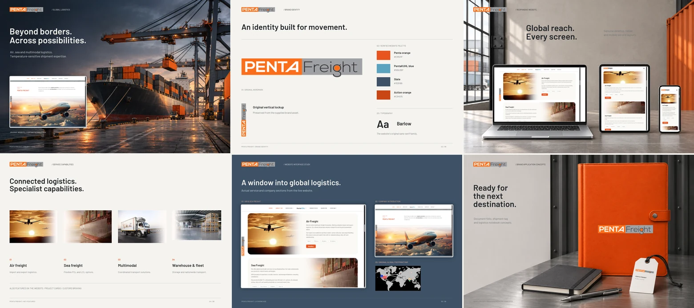

# Penta Freight

## Overview

Penta Freight is a responsive, single-page website presenting logistics services, company information, customer testimonials, certifications, awards, and office locations. It includes six service sections, a video hero, desktop dropdown navigation, and a mobile hamburger menu.

## Project Preview



The collage combines website interface previews with presentation and branding mockups.

## Key Features

- Six service cards covering air freight, sea freight, multimodal transport, project cargo, customs broking, and transit warehousing and fleet services.
- Responsive layouts with a desktop side logo and a horizontal logo in the mobile navbar.
- Section navigation, service-specific anchors, desktop dropdowns, and a mobile menu with Contact access.
- Video play/pause and mute controls, poster fallback, and playback-error feedback.
- Animated achievement counters and a scrolling certification strip with reduced-motion support.
- Testimonials, awards, a global footprint map, and India/USA office information.
- Keyboard focus styles, a skip link, and mobile menu focus handling.

## Live Website

[https://pentakuhl.vercel.app/](https://pentakuhl.vercel.app/)

## Technology Stack

React 19, Vite 8, Tailwind CSS 4, React Icons, ESLint, and Playwright Core.

## Getting Started

Use Node.js **20.19+ (20.x), 22.13+ (22.x), or 24+**, with npm. Run these commands from the repository root:

```sh
npm ci
npm run dev
```

Vite normally serves development at `http://localhost:5173`. No environment variables, API credentials, or database setup are required.

## Available Commands

| Command | Purpose |
| --- | --- |
| `npm run dev` | Start the development server. |
| `npm run build` | Generate the static production build in `dist/`. |
| `npm run preview` | Preview a production build locally. |
| `npm run lint` | Run ESLint. |
| `npm run test:browser` | Check the built application in headless Chromium. |

For browser checks, first build the application and install Chromium with `npx playwright-core install chromium`. The current test harness expects the checkout folder to be named `Pentakuhl - Penta Freight_Code`, with an existing sibling `Pentakuhl - Penta Freight_Docs` folder. It writes results there and screenshots to the sibling `Pentakuhl - Penta Freight_Visuals` folder. Set `PLAYWRIGHT_BROWSERS_PATH` when reusing an existing compatible browser cache.

## Project Structure

```text
public/                 Static images, video, favicon, and README preview
src/
  assets/               Bundled logo
  components/           Page sections and navigation
    ui/                 Shared heading, label, and scroll controls
  data/siteContent.js   Services, reviews, differentiators, and India offices
  App.jsx               Page composition
  index.css             Theme, shared styles, and motion preferences
  main.jsx              React entry point
tests/                  Browser regression check
```

## Current Scope

This is a frontend presentation website. It does not implement shipment tracking, quotations, form submission, authentication, APIs, or database storage. Industries, Careers, PentaKÜHL product entries, footer legal/social links, and the seven Read More buttons are intentionally retained as inactive controls.

The static output in `dist/` can be hosted on a static hosting service. The supplied live deployment uses Vercel.
